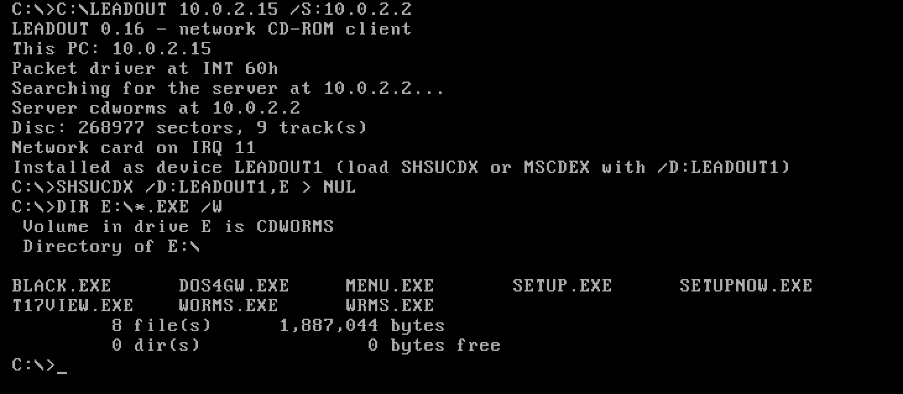

# LEADOUT: a network CD-ROM client for DOS

LEADOUT lets a DOS PC use CD images (ISO, BIN/CUE, MDF/MDS) from a LEADIN board on the local network.


- **Client:** `LEADOUT.COM`, a TSR for DOS (this repository). It finds the board and installs a CD-ROM device driver. SHSUCDX or MSCDEX then gives the device a drive letter.
- **Server:** [LEADIN](https://github.com/andreacampanella/LEADIN/tree/main), firmware for an Ai-Thinker ESP32 Audio Kit V2.2, in its own repository.

LEADOUT reads data tracks, plays CD audio, changes discs from DOS (`LEADOUT /DISC`). CD audio does not cross the network: the board plays it, and the PC sends only the play, stop and volume commands of the game.

Set up the board first, with [LEADIN](https://github.com/andreacampanella/LEADIN/tree/main).

## Files

| File | Description |
|------|-------------|
| `Makefile` | Builds the DOS folder and downloads OpenWatcom. See "Build" |
| `src/` | The client in C: `net.c` (resident network and protocol), `cdrom.c` (resident device driver), `init.c` (start-up and `/DISC`), `start.asm` (entry points), `build.sh` |
| `package/` | The other files of the DOS folder: `MOUNT.BAT`, `README.TXT`, `MTCP.CFG`, the packet driver |
| `tools/cdplay.asm` | `CDPLAY.COM`: plays CD audio tracks through MSCDEX or SHSUCDX (`CDPLAY 2`, `CDPLAY STOP`, `CDPLAY STATUS`) |
| `tools/cdspeed.asm` | `CDSPEED.COM`: measures the read speed (`CDSPEED`, or `CDSPEED 8` for 8 MB). Reads raw sectors through MSCDEX, no file system involved |

## Set up the DOS PC

Copy the `LEADOUT` folder of the release to `C:\LEADOUT`. You also need mTCP (for DHCP) and SHSUCDX or MSCDEX. Then:

```
C:\LEADOUT\MOUNT
```

`MOUNT` loads the packet driver, gets an address with DHCP, starts `LEADOUT`, and gives the CD a drive letter. If `MOUNT` does not find the board, give its address: `MOUNT 192.168.1.40`. See `package/README.TXT` for the options of `LEADOUT`.



## How it works

1. `LEADOUT.COM` finds the packet driver at INT 60h to 80h.
2. It sends a DISCOVER broadcast. The board answers with an OFFER: the disc name, its size and the track list. If the broadcast does not reach the board (Wi-Fi access points drop it), `LEADOUT` waits for the board's ANNOUNCE and sends the DISCOVER to the board directly.
3. It installs a CD-ROM device driver in the DOS device chain and stays resident (about 8.5 KB, plus a 16 KB read-ahead buffer).
4. When a program reads from the CD, SHSUCDX calls the driver. The driver sends a READ request and waits for the data, in parts of 1 KB. It asks again for the parts that get lost. A small read fetches a whole 16 KB block, and the next reads come from that buffer, as from a drive of its own.

The client answers ARP requests itself. It needs no TCP/IP stack.

## CD audio

LEADOUT supports these MSCDEX audio requests: PLAY AUDIO, STOP AUDIO (pause, then reset), RESUME AUDIO, the busy bit while audio plays, the Q-channel position, the audio status, and audio channel control (volume). The board plays the track and reports the position. While music plays, `LEADOUT` sends a heartbeat every 5 seconds. When the board hears nothing for the client timeout (15 seconds), it stops the music.

## Build

The Makefile works on Ubuntu or CachyOS:

```
make deps        # system packages, once (uses sudo, apt or pacman)
make setup       # downloads OpenWatcom 2 to ~/.leadout-tools, once
make             # the DOS folder, into dist/LEADOUT
make release     # dist/leadout-<version>.zip
```

To use an OpenWatcom that you have already, give `WATCOM=<folder>`.

### Build by hand

You need OpenWatcom 2.0 (`wcc` and `wlink`) and NASM.

```
src/build.sh
```

To use other names or paths for the tools, set `CC16` and `LINK16`. Do not use the environment variable `WCC` for the path: OpenWatcom reads extra compiler options from it.

### How the client is built

- `start.asm` sets the segment order. The resident part comes first: code (`_TEXT`) and data (`_DATA`). Then come the start-up strings (`CONST`) and the start-up code (`INIT_TEXT`). DOS frees this part when the program stays resident.
- `net.c` and `cdrom.c` must not use string literals or `const` data, because the compiler puts these in `CONST`. `build.sh` stops with an error if `CONST` moves into the resident part.
- OpenWatcom code expects SS to be equal to DS. The assembly entry points for the device driver and for the packet driver receiver switch to a private stack before they call C.
- No C library is linked. Small helpers (copy, multiply, divide) are inline assembly with `#pragma aux`.

## Known limits

- The client cannot be unloaded. Restart the PC to remove it.
- While LEADOUT is loaded, mTCP programs (PING, DHCP) cannot use the network, because LEADOUT uses the packet driver.
- The board answers any client. There is no session lock.